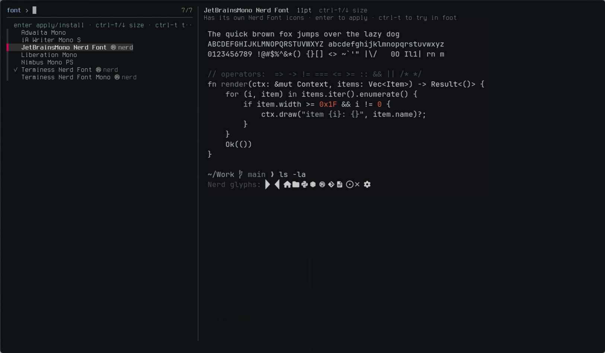

# fontpick

A terminal font picker for [Omarchy](https://omarchy.org/). Browse your installed
monospace fonts with a live, theme-coloured preview, set a size per font, try a
font in a real terminal window, and apply it system-wide. It can also install
Nerd Fonts from the Arch repos.



## Features

- **Accurate previews**: rendered with pango at the size your terminal would
  use, in your current Omarchy theme's colours, and shown inline as sixel images.
- **Per-font sizes**: fonts look good at very different sizes, so fontpick
  remembers a size for each one and applies it along with the font.
- **Try before applying**: `ctrl-t` opens a foot window in the selected font
  and size without changing anything.
- **Nerd Font awareness**: shows which fonts have their own Nerd Font icons,
  and `ctrl-a` lists uninstalled `ttf-*-nerd` / `otf-*-nerd` packages you can
  install with enter.

## Keys

| Key | Action |
|-----|--------|
| `enter` | Apply the font and its size (or install a `↓` package row) |
| `ctrl-↑` / `ctrl-↓` (or `alt-↑` / `alt-↓`) | Change the size in half-point steps; remembered per font |
| `ctrl-t` | Open a foot window in that font, without applying it |
| `ctrl-a` | Toggle showing installable Nerd Fonts |
| `esc` | Quit |

## Requirements

- Omarchy (it uses `omarchy-font-list`, `omarchy-font-set`, `omarchy-font-current`,
  `omarchy-pkg-add` and `omarchy-default-terminal`)
- A sixel-capable terminal for the image preview (foot works)
- `fzf` 0.44+, `pango` (`pango-view`), `imagemagick` (`magick`), `python3`, `foot`

## Install

```sh
curl -fsSL https://raw.githubusercontent.com/jaderfeijo/fontpick/main/fontpick -o ~/.local/bin/fontpick
chmod +x ~/.local/bin/fontpick
fontpick
```

## Notes

- Applying a font runs `omarchy-font-set`, then sets the size in the foot,
  alacritty, kitty and ghostty configs that exist, and signals kitty and
  ghostty to reload.
- The preview turns off programming ligatures when your default terminal is
  foot or alacritty, since those don't draw them.
- `omarchy-font-set` writes a fontconfig rule that makes requests for other
  monospace fonts resolve to the system font. Previews and try windows use a
  separate fontconfig setup without user rules, so each font shows as itself.
- Remembered sizes live in `~/.local/state/fontpick/sizes`, and rendered
  previews are cached in `~/.cache/fontpick`.

## License

[MIT](LICENSE)
